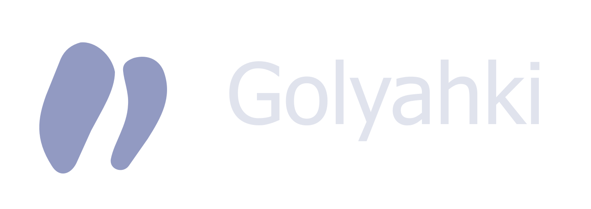
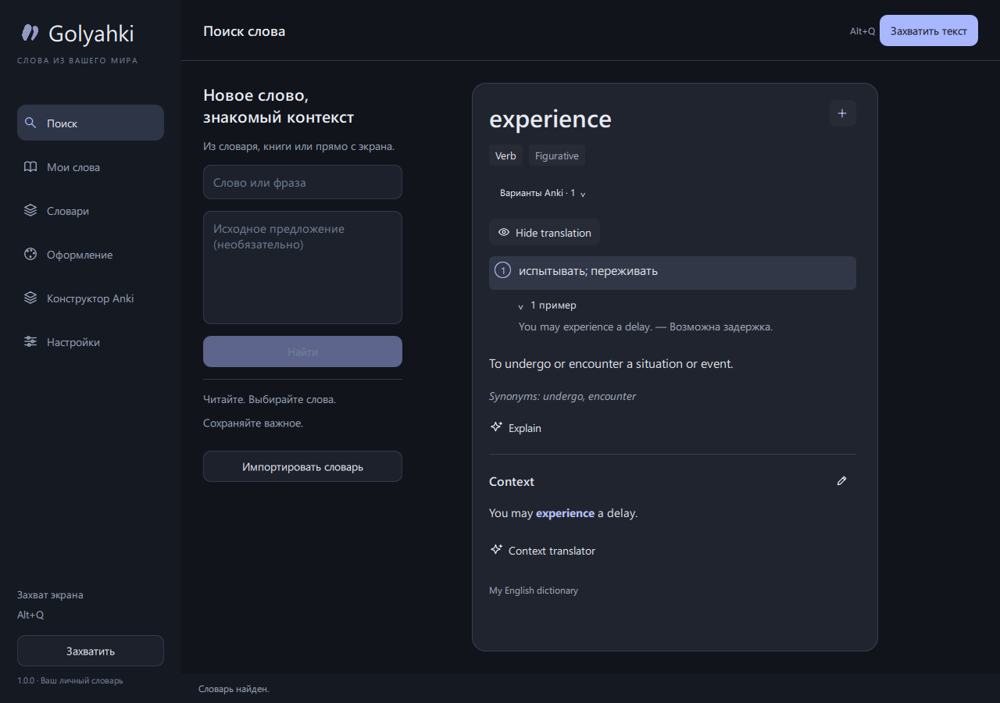

<p align="center">
  
</p>

<h1 align="center">Английский с вашего экрана — в вашу память</h1>

<p align="center">Захватите текст в игре, видео или приложении.<br>Узнайте значение, разберите контекст и сохраните слово в Anki.</p>

<p align="center">
  <a href="https://github.com/MrSamurai4/Golyahki/releases/latest"></a>
  <a href="LICENSE"></a>
</p>

<p align="center"><a href="README.en.md">English</a> · <a href="docs/USER_GUIDE.md">Руководство</a> · <a href="docs/PRIVACY.md">Данные и приватность</a> · <a href="https://github.com/MrSamurai4/Golyahki/issues">Сообщить об ошибке</a></p>

<p align="center"><a href="https://github.com/MrSamurai4/Golyahki/actions/workflows/checks.yml"></a></p>



## Что умеет Golyahki

| Возможность | Как это работает |
| --- | --- |
| **Текст с экрана** | `Alt+Q` распознаёт слова в выбранном окне или на мониторе. Нажмите слово, чтобы открыть карточку. |
| **Фразы и предложения** | Выделяйте диапазон через `Shift+клик`, добавляйте отдельные слова через `Ctrl+клик`. |
| **Локальные словари** | Импортируйте Yomitan v3 ZIP или собственный JSON: значения, формы слов и примеры доступны без интернета. |
| **Gemini по запросу** | Explain объясняет слово, Context translator переводит предложение. Используется ваш API-ключ. |
| **Личный Dictionary** | Сохраняйте слова с контекстом, редактируйте перевод, экспортируйте и импортируйте записи. |
| **Anki** | Передавайте все найденные значения и примеры. Доступны прямые, обратные карточки и предложения с пропусками. |
| **Оформление** | Настраивайте шрифт, цвета, размер карточки, затемнение и макеты Anki. |

Интерфейс — на русском; словари и подсказки ориентированы на изучение английского с русским переводом. Озвучки в этой версии нет.

## Скачать и запустить

1. Откройте [последний выпуск](https://github.com/MrSamurai4/Golyahki/releases/latest).
2. Скачайте **`Golyahki-1.0.0-windows-x64.zip`** из раздела Assets. Архив **Source code** предназначен для разработчиков.
3. Распакуйте **всю** папку `Golyahki` в удобное место.
4. Откройте **`Golyahki.exe`**. Установка Python и права администратора не нужны.

Не переносите один EXE отдельно: рядом должны оставаться `_internal` и `Golyahki-OCR.exe`. Программа распространяется без цифровой подписи; Windows может показать предупреждение о неизвестном издателе. Используйте выпуск из этого репозитория и при необходимости сравните SHA-256 с `SHA256SUMS.txt` из того же выпуска.

**Требования:** Windows 11 x64. Предпросмотр Anki использует [Microsoft Edge WebView2 Runtime](https://developer.microsoft.com/en-us/microsoft-edge/webview2/). Для WindowsOCR нужен английский компонент распознавания текста Windows; встроенный PaddleOCR доступен как запасной движок. macOS, Linux и Windows ARM в этом выпуске не поддерживаются.

## Первые пять минут

1. **Словари → Импортировать словарь:** выберите `examples/custom-dictionary.json` из распакованной папки. Найдите `experience` — это небольшой учебный пример. Для повседневной работы импортируйте свой английско-русский словарь Yomitan v3; большой словарь не включён в выпуск.
2. **Настройки → Gemini:** получите собственный ключ в [Google AI Studio](https://aistudio.google.com/api-keys) и сохраните его в программе. Выберите доступную вашему аккаунту модель. По умолчанию приложение запрашивает `gemini-2.5-flash`; доступность и тарифы зависят от Google.
3. **Настройки → Захват экрана:** выберите окно или монитор, затем нажмите **`Alt+Q`**. Щёлкните слово. **Esc** закрывает карточку и выделение.
4. **Explain** показывает объяснение; **Context translator** переводит контекст. Автоматического обращения к Gemini при обычном открытии словарной карточки нет.
5. Для карточек установите [Anki](https://apps.ankiweb.net/) и [AnkiConnect](https://ankiweb.net/shared/info/2055492159) (код `2055492159`). Перезапустите Anki, нажмите **Подключить Anki** в Golyahki и выберите свою колоду. Плюс в карточке сохраняет слово и отправляет его в выбранную колоду.

Anki и Gemini необязательны для локального поиска и OCR. Сохранение полной учебной записи через плюс запрашивает недостающие объяснения у Gemini: без ключа или при ошибке запись остаётся в **Черновиках**. Режим **Только Dictionary** отключает отправку в Anki, но не подготовку LLM-данных.

## Ваши данные

- Ключ вводится каждым пользователем самостоятельно и сохраняется в **Windows Credential Manager**. В репозитории и ZIP нет ключа автора.
- База, настройки, кеш переводов и личные слова находятся в `%LOCALAPPDATA%\GOlyah`, отдельно от папки приложения.
- Распознавание экрана выполняется локально. При обычном захвате изображение остаётся в оперативной памяти и не отправляется в Gemini.
- При запросе Gemini передаются выбранный текст, контекст и краткие словарные сведения. Добавление через плюс тоже может вызывать Gemini.
- У приложения нет собственного сервера, аккаунта или аналитики. Расходы за Gemini относятся к вашему проекту Google.

Подробнее: [какие данные где хранятся и как их удалить](docs/PRIVACY.md).

## Обновление и помощь

Закройте Golyahki через значок в трее, распакуйте новый выпуск в новую папку и запустите его. Личные данные подхватятся из `%LOCALAPPDATA%\GOlyah`. Перед обновлением полезно сделать экспорт слов; для полной резервной копии закройте приложение и скопируйте папку данных.

- [Горячие клавиши, словари и Anki](docs/USER_GUIDE.md)
- [Частые проблемы](docs/TROUBLESHOOTING.md)
- [Формат своего словаря](docs/DICTIONARY_FORMAT.md)
- [История изменений](CHANGELOG.md)
- [Запуск из исходников и сборка](docs/SETUP.md)
- [Проверки публичного выпуска](docs/VERIFICATION.md)
- [Как предложить улучшение](CONTRIBUTING.md)

## Разработка

Нужны Windows 11 и Python 3.11 x64. Из корня проекта:

```powershell
powershell -ExecutionPolicy Bypass -File scripts/setup.ps1
.\.venv\Scripts\python.exe -m golyah
.\.venv\Scripts\python.exe -m pytest -q
```

Для создания переносимой версии сначала подготовьте модели OCR, затем запустите сборку:

```powershell
.\.venv\Scripts\python.exe -m scripts.check_ocr --paddle
powershell -ExecutionPolicy Bypass -File scripts/build.ps1
```

Тесты используют временные базы и подменённые ответы Gemini/Anki. [Инструкция по сборке](docs/SETUP.md) описывает проверку готовых EXE и упаковку выпуска.

## Лицензия

Исходники Golyahki опубликованы под [MIT](LICENSE). Сторонние библиотеки, модели OCR и импортируемые словари имеют собственные лицензии; см. [THIRD_PARTY_NOTICES.md](THIRD_PARTY_NOTICES.md). Golyahki — независимый проект, не связанный с Google, Anki или Microsoft.
